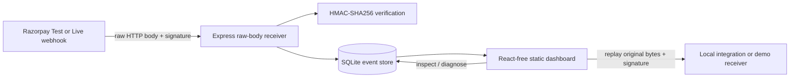

# WebHook-Dehook

A small Razorpay-focused webhook debugger for merchant integrations. It captures deliveries, verifies Razorpay signatures against the original request bytes, flags duplicate event IDs and likely payment-event ordering issues, explains common failures, and replays stored payloads to a local integration.

> This is a development/debugging tool, not a production webhook processor. It stores request payloads and headers, so protect access and avoid sending real customer data to an exposed instance.

## Features

- **Raw-body signature verification:** HMAC-SHA256 with `X-Razorpay-Signature`, checked before JSON parsing.
- **Durable event inbox:** SQLite stores the raw body, request headers, event ID/type, signature result, and receipt time.
- **Duplicate detection:** repeated `x-razorpay-event-id` values are retained and marked as duplicates.
- **Diagnosis panel:** signature guidance, duplicate warnings, and a best-effort warning when `payment.captured` has no earlier matching `payment.authorized` event.
- **Replay:** sends the exact stored bytes and original signature/event ID to the chosen HTTP(S) endpoint. Replay is restricted to localhost by default; remote replay requires `REPLAY_ALLOW_REMOTE=true` and should only be enabled in a trusted, access-controlled environment.
- **Failure simulator:** replay to `/demo/receiver` and switch between normal, 500, and delayed responses.
- **Filters:** event type, signature verification, and duplicate status.

## Architecture



The dashboard is plain HTML/CSS/JavaScript served by Express (no frontend build step).

## Run locally

Requires Node.js 20+ and a C++ build toolchain for `better-sqlite3`.

```bash
npm install
RAZORPAY_WEBHOOK_SECRET='your-razorpay-webhook-secret' npm start
```

Open <http://localhost:3000>. Configure the Razorpay webhook URL as `http://<your-tunnel-host>/webhooks/razorpay`, set the webhook secret in `RAZORPAY_WEBHOOK_SECRET`, and forward webhook requests to local port 3000 through your preferred tunnel. The webhook secret is not your Razorpay API key secret. Test and Live webhook configurations have separate secrets.

To allow multiple secrets during rotation, use a comma-separated environment variable:

```bash
RAZORPAY_WEBHOOK_SECRETS='current-secret,previous-secret' npm start
```

The dashboard reports whether at least one secret is configured. Events still get stored when the signature fails so you can inspect them.

## Docker Compose

```bash
RAZORPAY_WEBHOOK_SECRET='your-test-webhook-secret' docker compose up --build
```

The SQLite database persists in the `webhook_data` volume. The compose default is a local-only development secret; replace it before using the tunnel. Keep `REPLAY_ALLOW_REMOTE=false` unless the instance is access-controlled and remote replay is specifically needed.

## Common failures and fixes

| Symptom | Likely cause | Fix |
| --- | --- | --- |
| Signature mismatch | Body was parsed, changed, or re-serialized before hashing | Mount the raw-body handler before JSON middleware. This receiver does that on `/webhooks/razorpay`. |
| Signature mismatch only in one mode | Test/Live webhook secret mismatch, or API key secret used by mistake | Use the webhook secret configured for that Razorpay mode. |
| Same event appears more than once | Razorpay retried a delivery | Inspect the event ID and make downstream business processing idempotent. The debugger stores and marks repeats rather than discarding them. |
| Captured event appears before authorized | Delayed/out-of-order webhook delivery, or the authorization event was not captured here | Check the payment ID and delivery history; do not assume events always arrive in order. |
| Amount looks 100 times too large | Razorpay payment amounts are represented in the smallest currency unit (for INR, paise) | For example, `5000` paise is ₹50.00. |
| Old replay fails signature validation | The destination now uses a rotated webhook secret | The replay deliberately preserves the original signature. Verify using the historical secret or regenerate a signature only as an explicitly separate test operation. |

## Test

```bash
npm test
```

The tests cover valid, tampered, wrong-secret, and parse/serialize-changed signatures, repeated event IDs, and a likely out-of-order payment event. They use Razorpay-style test fixtures and do not call Razorpay.

## Demo flow

1. Start the app and send a test webhook to `/webhooks/razorpay` through a tunnel.
2. Select the event and inspect the raw payload, headers, verification result, and diagnosis.
3. Set the simulator to **Fail · 500 response**, then replay to the prefilled `/demo/receiver` URL.
4. Observe the 500 result, switch to **Normal · 200 OK**, and replay again.
5. Try a `payment.captured` fixture before an authorization fixture for the same payment ID to see the ordering warning.

## API

- `POST /webhooks/razorpay` — capture a Razorpay webhook; responds `200` after persisting the request.
- `GET /api/events?type=payment.captured&verified=false&duplicate=true` — list/filter events.
- `GET /api/events/:id` — event detail, parsed payload when available, headers, and diagnosis.
- `POST /api/events/:id/replay` with `{"url":"http://localhost:3000/demo/receiver"}` — replay stored bytes and original signature.
- `GET|POST /api/simulator` — inspect/set `normal`, `fail`, or `slow` demo behavior.
- `GET /api/health` — basic health and secret-configuration status.

## Notes and limitations

- HMAC validation is performed against the exact raw request body, before any body parser.
- The receiver acknowledges with 200 after SQLite persistence; it does not do downstream processing in the request path.
- Event ordering diagnosis is intentionally heuristic: it only knows about deliveries recorded in this database and compares the same payment ID.
- The app does not fetch payment details from Razorpay or validate webhook authenticity beyond the configured HMAC secret.
- Replay preserves the original signature. Rotating secrets may mean an old event no longer validates at its destination.
- No authentication is included. Do not expose this dashboard or webhook store publicly without adding access controls and data-retention protections.
