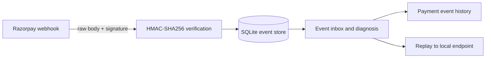

# WebHook-Dehook

**Inspect, diagnose, and replay Razorpay webhook deliveries.** WebHook-Dehook verifies signatures against the original request bytes, stores event history, flags duplicate IDs and possible payment-event ordering gaps, and helps troubleshoot merchant integrations.


## What it does

- Receives Razorpay webhooks at `POST /webhooks/razorpay`.
- Verifies `X-Razorpay-Signature` with HMAC-SHA256 using the exact raw body, before JSON parsing.
- Stores payload bytes, request headers, event ID/type, verification result, and receipt time in SQLite.
- Marks repeated `x-razorpay-event-id` values and provides a best-effort warning when a captured event has no earlier authorization delivery in recorded history.
- Displays event details and filters by event type, signature result, and duplicate status.
- Replays the original body and signature to a localhost destination by default.
- Simulates normal, failed, and delayed local receiver responses.

## Workflow



The dashboard is plain HTML, CSS, and JavaScript served by Express; no frontend build step is needed.

## Run locally

Requires Node.js 20+ and a native build toolchain for `better-sqlite3`.

```bash
npm install
RAZORPAY_WEBHOOK_SECRET='your-test-webhook-secret' npm start
```

Open <http://localhost:3000>. Configure the Razorpay Test Mode webhook URL as `https://<your-tunnel>/webhooks/razorpay` and forward the tunnel to port 3000.

The webhook secret is separate from the Razorpay API key secret. Test and Live webhook configurations have different secrets. To accept multiple secrets during rotation:

```bash
RAZORPAY_WEBHOOK_SECRETS='current-secret,previous-secret' npm start
```

## Docker Compose

```bash
RAZORPAY_WEBHOOK_SECRET='your-test-webhook-secret' docker compose up --build
```

SQLite data persists in the `webhook_data` volume. Replay to non-local destinations is disabled unless `REPLAY_ALLOW_REMOTE=true` is explicitly configured.

## Troubleshooting guide

| Symptom | Possible cause | What to check |
|---|---|---|
| Signature mismatch | Body was parsed or changed before hashing; incorrect webhook secret | Verify the raw request bytes first. Confirm the secret belongs to this webhook and Test/Live mode. |
| Same event appears more than once | Retried delivery | Compare `x-razorpay-event-id`; make the merchant's processing idempotent. |
| Captured event appears before authorized | Delayed/out-of-order delivery, or the earlier event is not in this inbox | Compare payment IDs and timestamps; do not assume events always arrive in order. |
| Amount looks too large | Amount is expressed in the currency's smallest unit | For INR, 5000 paise is ₹50.00. Use the event currency when formatting. |
| Replay signature fails after secret rotation | Destination checks only the current secret | Replay preserves the original body and signature; check with the appropriate historical secret. |

## Demo walkthrough

1. Start the server and send a Test Mode webhook to `/webhooks/razorpay` through a tunnel.
2. Select the event to inspect its payload, headers, signature result, and diagnosis.
3. Set the simulator to **Fail · 500 response**, then replay to the local demo receiver.
4. Observe the response and switch back to **Normal · 200 OK** to replay again.
5. Send a `payment.captured` event before an authorization event to inspect the ordering warning.

## API

- `POST /webhooks/razorpay` — store and verify a webhook, then acknowledge with HTTP 200.
- `GET /api/events` — list events; supports `type`, `verified`, and `duplicate` filters.
- `GET /api/events/:id` — retrieve event detail, payload, headers, and diagnosis.
- `POST /api/events/:id/replay` with `{"url":"http://localhost:3000/demo/receiver"}` — replay stored bytes and signature.
- `GET|POST /api/simulator` — inspect or set `normal`, `fail`, or `slow` demo behavior.
- `GET /api/health` — check server health and whether a webhook secret is configured.

## Tests

```bash
npm test
```

The test suite covers valid, tampered, wrong-secret, and parse/serialize-changed signatures; repeated event IDs; and a possible out-of-order payment event.

## Project scope

The payment-order warning is heuristic: it only uses deliveries recorded in this database and does not prove a provider event was lost. Replay sends the stored signature unchanged, so secret rotation may require checking with a historical secret at the destination.

## Data handling

Webhook request bodies and headers are stored in the local SQLite database. Use test-mode events and keep the database and any tunnel access limited to people who need it. Never commit API keys, webhook secrets, or customer data.
