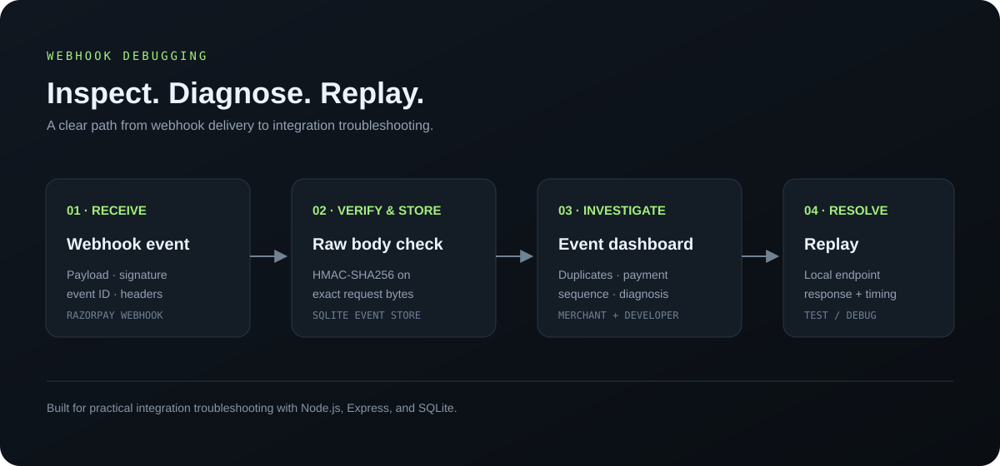

# Razorpay webhook debugger: verifies signatures on raw bodies, flags duplicates and out-of-order events, and replays payloads.

Capture Razorpay webhook deliveries, validate HMAC signatures against raw request bytes, inspect duplicate and payment-order issues, and replay events to a local endpoint.



## Features

- Raw-body HMAC-SHA256 validation before JSON parsing.
- SQLite event inbox with event ID/type, headers, verification result, and receipt time.
- Duplicate detection and best-effort `payment.captured` ordering diagnosis.
- Email, phone, and sensitive-field redaction in dashboard/API representations.
- HTTP Basic Auth for the dashboard and APIs via `DASHBOARD_PASSWORD`.
- Localhost-only replay by default and a normal/fail/slow demo receiver.
- Tests for valid, tampered, wrong-secret, and parse/serialize-changed signatures.

## Run locally

Requires Node.js 20+ and a native build toolchain for `better-sqlite3`.

```bash
npm install
export DASHBOARD_PASSWORD='choose-a-local-password'
export RAZORPAY_WEBHOOK_SECRET='your-test-webhook-secret'
npm start
```

Open <http://localhost:3000>. Dashboard HTTP Basic Auth username is `admin`; password is the value of `DASHBOARD_PASSWORD`. The webhook receiver remains accessible without dashboard login. For Razorpay Test Mode, configure `https://<your-tunnel>/webhooks/razorpay` and forward the tunnel to port 3000.

The webhook secret is separate from the Razorpay API key secret. Test and Live webhook configurations have separate secrets. During secret rotation, configure `RAZORPAY_WEBHOOK_SECRETS='current-secret,previous-secret'` for the overlap period.

## Docker Compose

```bash
export DASHBOARD_PASSWORD='choose-a-local-password'
export RAZORPAY_WEBHOOK_SECRET='your-test-webhook-secret'
docker compose up --build
```

## Demo flow

1. Start the server and send a Test Mode webhook through a tunnel.
2. Select the event to inspect verification status, redacted payload, headers, and diagnosis.
3. Set the simulator to return 500 and replay to the local demo endpoint; switch it to normal and replay again.
4. Review the event ID and payment-order diagnosis.

## API

- `POST /webhooks/razorpay` — receive and persist a webhook, then return 200.
- `GET /api/events` — list/filter events by type, signature result, or duplicate status.
- `GET /api/events/:id` — inspect redacted event details and diagnosis.
- `POST /api/events/:id/replay` — replay stored bytes and original signature to an allowed HTTP(S) target.
- `GET|POST /api/simulator` — inspect or set `normal`, `fail`, or `slow` demo behavior.
- `GET /api/health` — basic health/configuration status.

## Tests

```bash
npm test
```

GitHub Actions runs the tests on pushes and pull requests.

## Data handling

The event store retains the original raw payload for signature validation and replay. PII is redacted in dashboard/API views, while the SQLite database keeps original bytes. Use synthetic/test-mode data and protect the local database.
