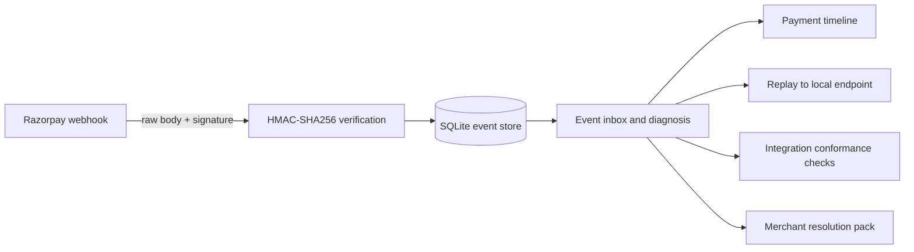

# WebHook-Dehook

Razorpay webhook debugging for merchant integrations: capture deliveries, verify signatures against the original request bytes, inspect duplicates and payment-event ordering, and replay events to a local endpoint.



## Features

- Raw-body HMAC-SHA256 signature verification before JSON parsing.
- SQLite event inbox with request headers, event ID/type, verification result, and receipt time.
- Duplicate event-ID detection and a best-effort warning for captured events with no earlier authorization delivery recorded here.
- Event filters, redacted event details, and merchant-friendly explanations alongside technical fixes.
- Localhost-only replay by default, response status and duration, and confirmation for risky replay events.
- Integration conformance checks for signed, tampered, wrong-secret, duplicate, captured-first, and response-time cases.
- Payment timelines and template-generated merchant reply, engineering note, and FAQ.
- Optional Razorpay Fetch Payment API reconciliation.

## Run locally

Requires Node.js 20+ and a native build toolchain for `better-sqlite3`.

```bash
npm install
export DASHBOARD_PASSWORD='choose-a-local-password'
export RAZORPAY_WEBHOOK_SECRET='your-test-mode-webhook-secret'
npm start
```

Open <http://localhost:3000>. Dashboard HTTP Basic Auth username is `admin`; the password is `DASHBOARD_PASSWORD`. For Test Mode, configure the webhook URL as `https://<your-tunnel>/webhooks/razorpay` and forward the tunnel to port 3000.

The webhook secret is separate from the Razorpay API key secret. Test and Live webhook configurations have separate secrets. During secret rotation, configure `RAZORPAY_WEBHOOK_SECRETS='current-secret,previous-secret'` for the overlap period. Keep secrets in environment configuration, not source control.

### Docker Compose

```bash
export DASHBOARD_PASSWORD='choose-a-local-password'
export RAZORPAY_WEBHOOK_SECRET='your-test-mode-webhook-secret'
docker compose up --build
```

## Integration conformance

Enter a local/test endpoint URL, its test webhook secret, and a response-time threshold. The report shows observed HTTP status, elapsed time, pass/fail, and a suggested fix.

| Check | Expected behavior |
|---|---|
| Valid signed event | 2xx within the threshold |
| Tampered body with original signature | 4xx |
| Wrong signing secret | 4xx |
| Duplicate delivery | Safe, prompt response; verify business side effects separately |
| Captured before authorization | Endpoint remains available; verify state handling separately |
| Response time | Measured against the chosen threshold |

Use a disposable test endpoint. Synthetic requests can change target application state. HTTP responses alone cannot prove exactly-once fulfillment or correct database changes.

## Replay and resolution packs

Replay sends stored raw bytes and the original signature. It is restricted to localhost by default and requires confirmation for duplicate and `payment.captured` events. Replays can trigger business actions again, so the receiving integration should be idempotent. Replay results include response status and elapsed time.

The resolution pack generates a plain-English merchant reply, an engineering note with reproduction guidance, and an FAQ/playbook draft.

## Payment reconciliation

`POST /api/reconcile` calls Razorpay Fetch Payment API and compares the returned status with events recorded in this tool. An API status of `captured` without a recorded `payment.captured` event may indicate a missed delivery or a different configured endpoint. Use Test Mode API credentials only.

## API and Postman

Import `docs/WebHook-Dehook.postman_collection.json` and configure `baseUrl`, `basicAuth` (base64 of `admin:<DASHBOARD_PASSWORD>`), and Test Mode credentials in your local Postman environment.

| Endpoint | Purpose |
|---|---|
| `POST /webhooks/razorpay` | Raw-body receiver; persist and acknowledge |
| `GET /api/events` | List and filter deliveries |
| `GET /api/events/:id` | Redacted payload, headers, and diagnosis |
| `GET /api/payments/:paymentId/timeline` | Payment events in receipt order |
| `POST /api/events/:id/replay` | Guarded replay to HTTP(S) destination |
| `POST /api/events/:id/resolution-pack` | Merchant reply, engineering note, FAQ draft |
| `POST /api/conformance/run` | Test endpoint conformance checklist |
| `POST /api/reconcile` | Compare recorded events to Fetch Payment API |
| `GET|POST /api/simulator` | Local demo target: normal, fail, slow |
| `GET /api/health` | Basic app and secret-configuration status |

## Case studies

### “Payment succeeded but the order is still pending.”

- **Diagnosis:** Signature mismatch, or the merchant app did not accept a valid delivery.
- **Root cause:** JSON parsing happened before raw-body verification, or the wrong webhook secret was configured.
- **Fix:** Verify HMAC over exact request bytes before parsing. Use the webhook secret for the matching mode—not the API key secret.
- **Playbook:** Validate raw bytes first; parse JSON only after successful validation.

### “One payment caused two fulfillment messages.”

- **Diagnosis:** The same event was processed more than once.
- **Root cause:** A retry was not handled idempotently.
- **Fix:** Deduplicate on event ID and make fulfillment safe to repeat.
- **Playbook:** A 2xx response acknowledges receipt; it does not promise exactly-once processing.

### “Captured arrived before authorized.”

- **Diagnosis:** This inbox did not record an earlier authorization for that payment.
- **Root cause:** Delayed/out-of-order delivery, or an earlier event was not captured here.
- **Fix:** Handle payment state transitions without assuming strict order; reconcile uncertain state with the payment API.
- **Playbook:** Treat ordering warnings as investigation candidates, not proof that an event was lost.

### “The amount shown is 100 times too large.”

- **Diagnosis:** The amount was displayed as whole rupees.
- **Root cause:** Amounts use the currency's smallest unit; 5000 paise is ₹50.00.
- **Fix:** Format using the actual currency and its minor-unit rules.
- **Playbook:** Include currency and unit conversion in merchant-facing displays.

### “Replay stopped working after secret rotation.”

- **Diagnosis:** The destination accepts the new secret but not the historical signature's secret.
- **Root cause:** Replay preserves the original body/signature; changing the body invalidates that signature.
- **Fix:** Verify using the appropriate historical secret, or create a separately identified re-signing test mode.
- **Playbook:** Keep secrets distinct by webhook and mode; document rotation overlap and retirement.

## Merchant onboarding checklist

1. Confirm Test or Live mode and verify the configured URL routes to the intended app.
2. Use the webhook secret for that webhook; do not substitute the API key secret.
3. Capture raw request bytes and verify the signature before JSON parsing.
4. Persist the event, return 2xx promptly, and do slow work after durable receipt.
5. Deduplicate event IDs and tolerate retries and out-of-order state changes.
6. Reconcile uncertain payment status and document the resolution.

## Tests

```bash
npm test
```

The tests cover raw signature verification, tampering, wrong secrets, duplicate IDs, PII masking, dashboard authentication, and target safety.

## Security notes

Webhook payloads are stored as raw bytes in SQLite for signature debugging. Email, phone, and sensitive fields are redacted in dashboard/API representations, but the original database contents remain unredacted. Protect the database and use synthetic data for demos. Keep replay restricted to localhost unless a trusted, access-controlled deployment specifically needs remote replay. Use Test Mode credentials for demos and reconciliation.
